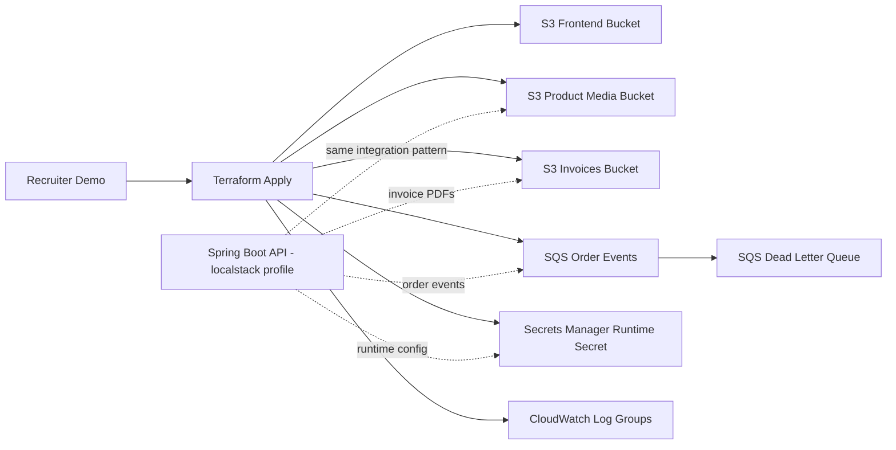

# ShopSphere AWS Demo Screenshots

This is a short-lived AWS demo. Create it, capture screenshots, then destroy it.

## Architecture



## Before Apply

1. Confirm you are using the correct AWS account.
2. Confirm AWS region, default is `eu-west-3`.
3. Create or verify a small AWS Budget alert manually in AWS Console.

## Apply

```powershell
cd C:\Users\moham\Desktop\ecommerce\ecommerce-boutique\infra\terraform\aws-demo
terraform init
terraform plan
terraform apply
```

Screenshot to capture:

- terminal showing `Apply complete!`
- Terraform outputs

## AWS Console Screenshots

Filter by tag:

```text
Project = ShopSphere
Environment = demo
Purpose = RecruiterDemo
```

Capture:

- S3 buckets: frontend, media, invoices
- SQS queue and DLQ
- Secrets Manager secret
- CloudWatch log groups
- this architecture diagram

## Destroy

```powershell
terraform destroy
```

Screenshot to capture:

- terminal showing `Destroy complete!`

## Final Check

After destroy, verify these pages do not show ShopSphere demo resources:

- S3
- SQS
- Secrets Manager
- CloudWatch Logs
